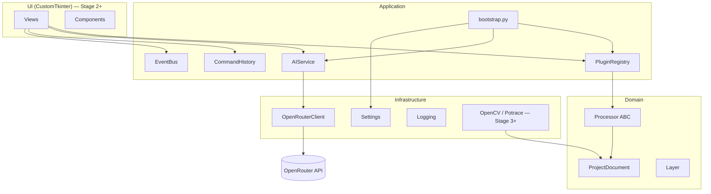
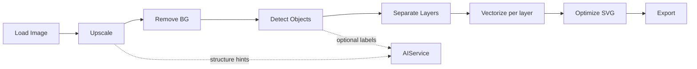

# Architecture Overview — Stage 1

## Goals

- Clean separation of UI, application services, domain models and infrastructure.
- AI fully decoupled behind `AIService` / `OpenRouterClient`.
- Processors as replaceable Strategies registered via plugins.
- Offline-first vectorization path.

## Layer diagram

## Pipeline (planned)

## Dependency rule

Inner layers never import UI. Infrastructure adapters are injected from `src/core/bootstrap.py`.
